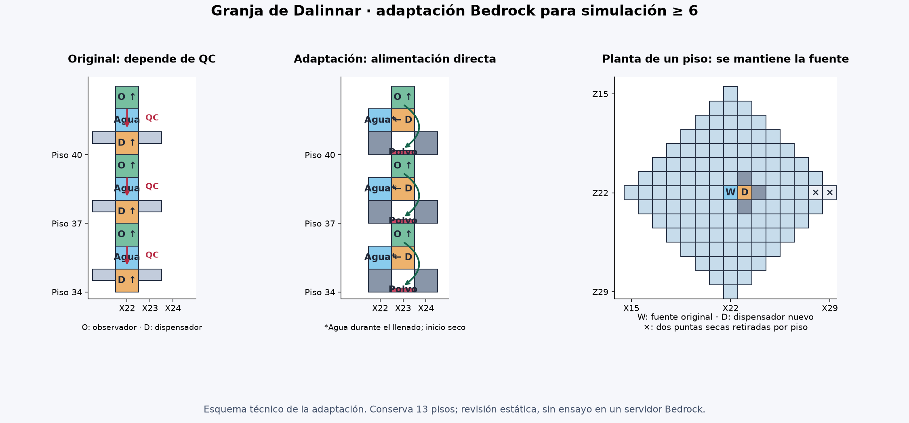

# Granja de mobs: adaptación para Bedrock, simulación de 6 chunks o más

[Descargar el .litematic](https://github.com/dauri2000/dauri/raw/refs/heads/codex/if35-download/granjas/early-game-bedrock/early_game_mob-farm_Bedrock_SD6.litematic)

Original: **Dalinnar**, `early game mob-farm`. Se conserva su autor en el archivo. Adaptación del archivo que aportó el usuario; no es un mundo ni una actualización del mod. El formato sigue siendo **.litematic para Litematica** en el cliente Java que se conecta a Bedrock.

## Cómo funciona el original

Tiene 13 plataformas de losas superiores con separación de 3 bloques. Cada dispensador central suelta y recoge agua; el agua empuja los mobs a la balsa inferior. Las corrientes de esa balsa los dirigen a una abertura de 5×5 con puertas de valla abiertas, y caen unos 31 bloques hasta las 25 tolvas. Es una granja de **objetos por caída**, no una granja automática de experiencia.

Arriba hay un reloj de dos tolvas, dos comparadores y dos pistones pegajosos. La cadena vertical original tiene un observador mirando arriba, una celda de agua debajo y después el dispensador: depende de la cuasiconectividad de Java para activar ese dispensador a distancia. Esa alimentación no existe en Bedrock.

## Qué se conserva y qué cambia

- Se conservan los **13 pisos**, sus alturas, la separación, la fuente central de cada piso, la balsa, sus **64 fuentes fijas**, el agujero, la caída y las **25 tolvas** de recogida.
- Se mantienen las dos tolvas, comparadores y pistones del reloj; la palanca pasa al otro lado del mismo bloque. Su temporizador lleva **16 adoquines**, equivalentes para el reloj a los 16 observadores que había dentro.
- Se reubican los **13 dispensadores y 14 observadores**. Cada dispensador queda al este de su fuente, mirando al **oeste**. Un observador encima mira hacia **arriba** y alimenta directamente el dispensador de abajo. El dispensador conduce el pulso al polvo que tiene debajo; ese polvo lo observa el siguiente módulo inferior. La señal no depende de observar cambios del agua.
- El nuevo dispensador obstruye un paso del agua hacia el este. Se quitan **dos losas por piso, 26 en total**, para no dejar puntas secas donde se acumulen mobs. El resto de superficies transitables está dentro de siete pasos horizontales desde la fuente, rodeando el dispensador.
- Cuatro bloques macizos sellan lateralmente cada celda de polvo. Se refuerza el techo con piedra en la misma huella y se reutilizan sus losas como cubierta superior que impide apariciones. Esto asegura un techo opaco; no se afirma que las losas originales fueran incompatibles.
- Se abre la única puerta que estaba cerrada, se añaden dos cofres a la salida existente y una plataforma AFK cubierta arriba. Las tolvas de recogida salen vacías: no se copian los objetos de prueba del original.

## Construcción y puesta en marcha

1. Carga el archivo en Litematica y conserva su orientación y la de los componentes. En particular: **los 13 dispensadores miran al oeste y los 13 observadores de la columna miran arriba**; el observador que lee el comparador del reloj mira al oeste. Si giras todo el esquema, gira todos estos sentidos con él.
2. Construye la estructura y el circuito completos **antes de cargar los cubos**. Conserva las fuentes de la balsa inferior; las plataformas de aparición empiezan secas. No rellenes de agua las celdas ocupadas por el cableado.
3. Pon la palanca del reloj en encendido para detenerlo. Deja una tolva del reloj vacía y **16 adoquines en la otra** (la situada al norte, coordenada local `22,74,20`). No repartas objetos entre ambas.
4. Pon **un cubo de agua, y ningún otro objeto, en cada uno de los 13 dispensadores**. Litematica en supervivencia no coloca automáticamente el contenido de inventarios. El archivo incluye ese contenido para herramientas que sí lo copien.
5. Apaga la palanca para arrancar. Comprueba desde fuera que el primer pulso inunda los 13 pisos en cascada y el siguiente recoge sus fuentes. Si al construir se activó un piso antes de tiempo, detén el reloj, recoge solo el agua de ese piso y vuelve a dejar su dispensador con un cubo de agua. Las fuentes permanentes de la balsa se quedan puestas.
6. Para usarla, sitúate en el **centro de la plataforma de vidrio de arriba**. Ese punto tiene los pies a `100` bloques por encima del nivel de las tolvas de recogida. Mantén la simulación en **6 chunks o más**, dificultad que permita monstruos y aparición de mobs habilitada.

No cambies los pisos de losas superiores por losas inferiores: perderían su superficie de aparición. No tapes con bloques la celda de aire situada junto a la palanca original: es necesaria para la bajada del polvo del reloj. El esquema ya la deja libre.

## Ubicación

Conviene construir sobre un océano, lejos de tierra y de otras zonas donde puedan aparecer monstruos. Por ejemplo, con las tolvas de recogida en **Y=100**, estarás AFK en **Y=200** y el último techo quedará en **Y=202**. No construyas puentes o plataformas adicionales sin impedir apariciones en ellos. En un servidor, otros jugadores y el límite compartido de mobs también afectan al rendimiento.

Si colocas la esquina inferior mínima del esquema en `(X0,Y0,Z0)`, el centro AFK tiene los pies en `(X0+22.5,Y0+100,Z0+22.5)`. Se conserva esa esquina mínima del original; la altura total pasa de 77 a 103 por el punto AFK.

## Materiales principales del esquema

| Material | Cantidad |
|---|---:|
| Losas de piedra lisa | 2402 |
| Piedra | 1566 |
| Losas de piedra | 156 |
| Tolvas | 27 (25 recogida + 2 reloj) |
| Puertas de valla de roble | 25 |
| Observadores | 14 |
| Dispensadores | 13 |
| Polvo de redstone | 18 |
| Comparadores | 2 |
| Pistones pegajosos | 2 |
| Bloque de redstone | 1 |
| Palanca | 1 |
| Cofres | 2 |
| Vidrio | 9 |

Además: **13 cubos de agua** para los dispensadores y **16 adoquines** para el reloj. Las 64 fuentes de la balsa pueden ponerse con agua reutilizada; no hacen falta 64 cubos distintos. La cabeza de pistón que aparece en el archivo es parte de uno de los dos pistones, no un material extra.

## Comprobaciones y límite de la entrega

Se ha leído el NBT original, conservado su autor y versión de datos, revisado el circuito con una referencia independiente de implementación Bedrock, comprobado las coordenadas y el alcance geométrico del agua, y reabierto el archivo final con un lector independiente. Desde el punto AFK, los pisos están aproximadamente a 29–66 bloques y las tolvas a 99 bloques, dentro de 24–128 con simulación de 6 o más.

**No se ha ejecutado esta granja en un servidor Bedrock real.** La descarga del servidor oficial estaba bloqueada en este entorno. La revisión de referencia y la geometría permiten proponer esta adaptación, pero no medir producción ni garantizar el comportamiento exacto de los pulsos en todas las versiones del servidor. La comprobación de los 13 llenados y vaciados del paso 5 sigue siendo necesaria. Tampoco se prometen las tasas de aparición de Java: Bedrock tiene sus propios límites de población.
